# Student Dropout Prediction with Bagging & Random Forest

**Source:** `notebook.ipynb`. All figures are exported from the notebook outputs into `reports/figures/`.
**Dataset:** `data/student_dropout.csv`: 12,000 students, 21 predictors, binary target `dropout` (1 = the student dropped out).

---

## Executive summary

- A **Random Forest** (375 trees, `max_depth=20`, `max_features=12`, `min_samples_leaf=5`) predicts dropout with a **test ROC AUC of 0.95**.
- At the default cutoff of 0.5 the model detects **79.2%** of the students who drop out (recall), and **77.7%** of the students it flags actually drop out (precision). The test F1 is 78.4%.
- **Bagging and Random Forest perform the same** (CV F1 0.779 vs 0.781). The difference is within the noise of cross-validation.
- The strongest drivers of dropout are **academic performance** (`sem2_gpa`, `sem1_gpa`), **engagement** (`attendance_pct`, `study_hours_week`) and **workload/wellbeing** (`part_time_job_hours`, `stress_index`). Demographics (`gender`, `program`, `age_at_enrollment`, `international`) have almost no effect.
- Under the example cost matrix, the **profit-optimal cutoff is 0.17**. It catches **94.2%** of dropouts, and the profit per student on the test set rises to **721 €**, against 626 € at the 0.5 cutoff.

---

## 1. Data

| Item | Value |
|---|---|
| Rows / columns | 12,000 / 23 |
| Missing values | None |
| Target distribution | 78.0% stayed / 22.0% dropped out (imbalanced) |
| Categorical variables | `gender` (3 levels), `program` (8 levels) |
| Binary variables | `international`, `first_generation`, `scholarship`, `tuition_debt` |

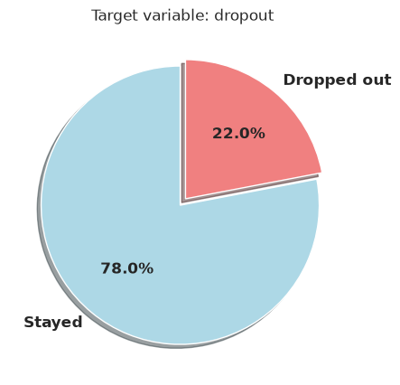

**Findings**
- The classes are imbalanced: about one student in five drops out. Accuracy alone would be misleading, because a model predicting "stayed" for everyone would be 78% accurate. We therefore use **F1** to tune the models, stratify the split and the cross-validation, and use `class_weight='balanced_subsample'`.
- Small groups: only 258 students are `Non-binary` and 616 are in `Law`.
- `sem1_gpa`, `sem2_gpa` and `final_gpa` measure the same thing at different moments, so they are strongly related. Their importance is shared when interpreting the model.

### Columns removed before modelling

| Column | Reason |
|---|---|
| `student_id` | Identifier only: carries no information. |
| `final_gpa` | Only known at the **end** of the studies. A student who drops out gets a low or zero final GPA *because* they dropped out, so the column contains the answer. It would not be available at the moment we want to identify students at risk. |

---

## 2. Train/test split and pre-processing

- **Split:** 70% training (8,400 students), 30% test (3,600 students), stratified. Both sets keep the 78% / 22% class ratio.
- **Pre-processing:** a `ColumnTransformer` imputes numeric variables (median) and one-hot encodes the categorical variables. It is fitted on the training set only and then applied to the test set. This gives **29 variables** after encoding.
- No scaling: tree-based models do not need it.
- All decisions (hyper-parameters, number of trees, cutoffs) were taken with the **training data only** (cross-validation or OOB). The test set is used only to report results.

---

## 3. Model selection: Bagging vs Random Forest

Both models are tuned with Grid Search, 5-fold stratified cross-validation and F1 as the metric. Both use `class_weight='balanced_subsample'` to handle the imbalance.

### A. Bagging (`max_features=None`)

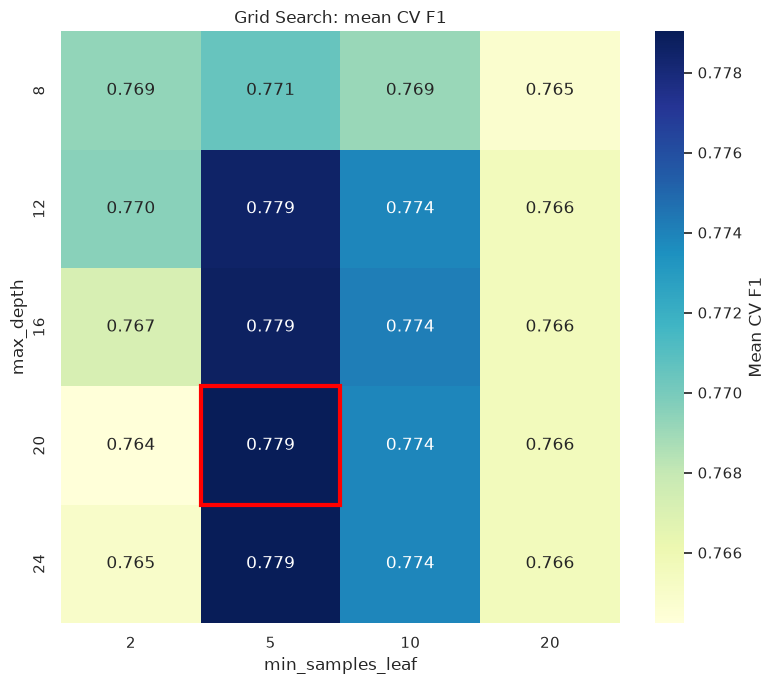

- Best parameters: `max_depth=20`, `min_samples_leaf=5`. **CV F1 = 0.779**.
- `min_samples_leaf=5` is clearly better than 2 (overfits) and 10–20 (underfits).
- For `max_depth ≥ 12` the score does not change: with at least 5 students per leaf, the trees stop growing before they reach the depth limit.

### B. Random Forest (`max_features` tuned)

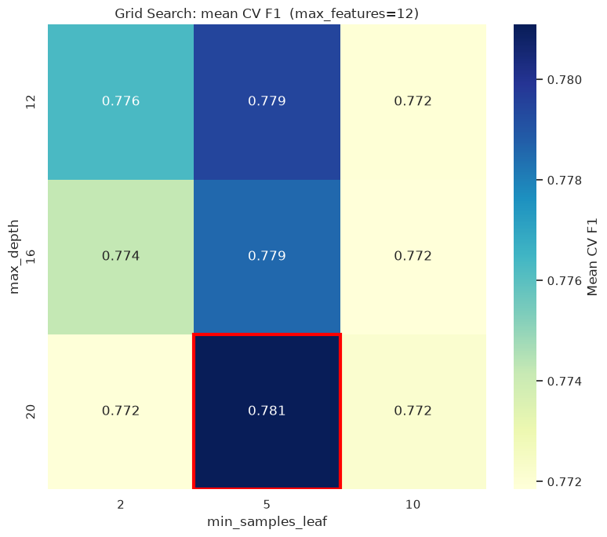

- Best parameters: `max_features=12`, `max_depth=20`, `min_samples_leaf=5`. **CV F1 = 0.781**.
- The grids were extended after a first search found the optimum at the edges. The final optimum is inside the grid.

### Train vs OOB vs CV (F1, cutoff 0.5)

| Model | Train (in-bag) | OOB | CV | Train − OOB gap |
|---|---|---|---|---|
| Bagging | 92.7% | 78.3% | 77.9% | 14.4% |
| Random Forest | 92.0% | 77.6% | 78.1% | 14.4% |

**Findings**
- The two "honest" estimates (OOB and CV) agree closely for both models, so ~78% F1 is a reliable estimate of performance on new students.
- The 14% gap between Train and OOB is flagged as overfitting. It is expected with deep trees, which fit the training rows very well. The test results (Section 5) confirm that the generalisation estimate is accurate.
- **Bagging and Random Forest are practically equivalent** here (0.779 vs 0.781). The Random Forest was kept as the final model.

---

## 4. Number of trees (OOB)

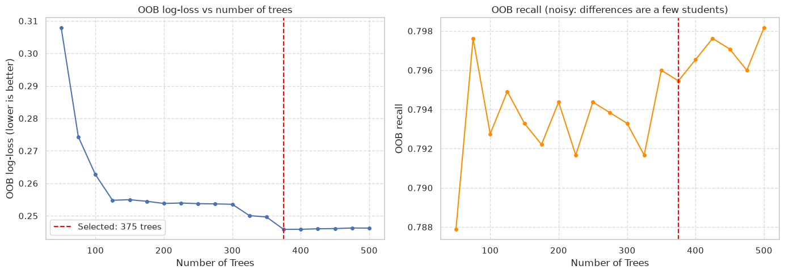

- The OOB log-loss falls quickly up to ~125 trees, has a last small drop around 325–375 trees, and is flat afterwards.
- **375 trees** were selected (OOB log-loss within 0.001 of the minimum).
- OOB recall only moves between 78.8% and 79.8%. These are differences of a few students: noise, not signal.

---

## 5. Final model performance (test set)

### Precision–Recall trade-off (OOB)

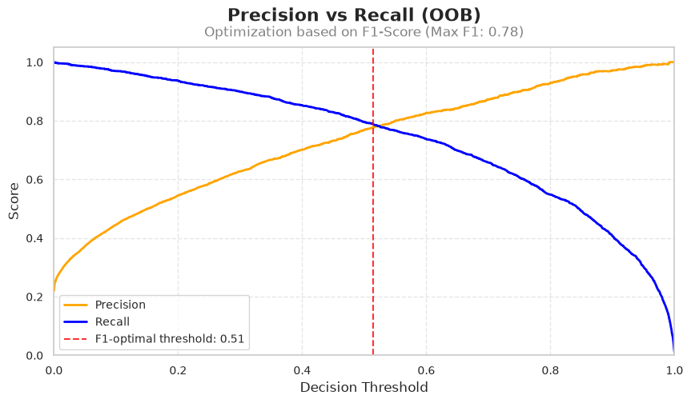

The F1-optimal cutoff on the OOB predictions is **0.51**, practically the default. The maximum OOB F1 is 0.78.

### Confusion matrix at cutoff 0.5

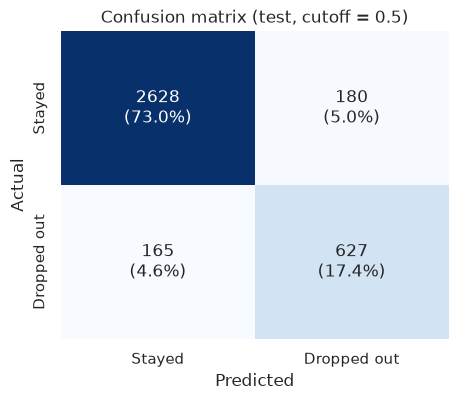

| | Predicted: stayed | Predicted: dropped out |
|---|---|---|
| **Actual: stayed** | 2,628 (TN) | 180 (FP) |
| **Actual: dropped out** | 165 (FN) | 627 (TP) |

- **Recall 79.2%** (approx. 95% interval 76.3%–82.0%, based on 792 dropouts in the test set).
- **Precision 77.7%**.
- The test results match the OOB and CV estimates, which confirms that the model generalises as expected.

### ROC curve

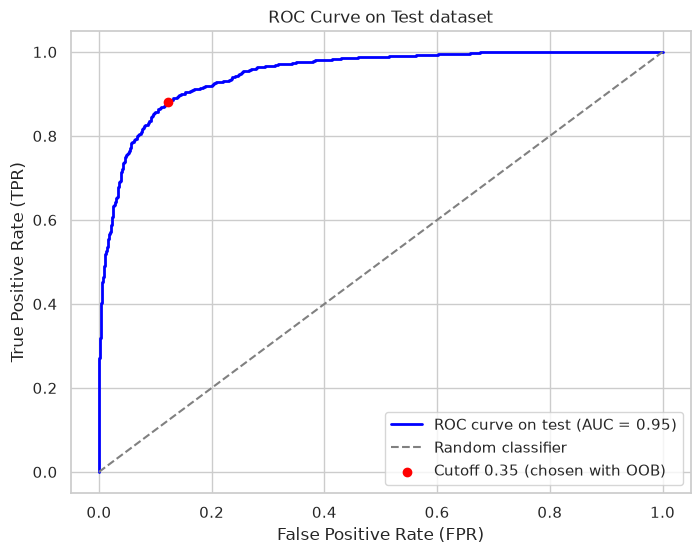

- **Test AUC = 0.95**: the model ranks students at risk above students who stay very well.
- The Youden cutoff (maximum TPR − FPR, chosen with OOB) is **0.35**. On the test set it gives 88.0% recall with ~12% false positive rate.

---

## 6. Interpretation: what drives dropout?

### Impurity-based feature importances (train)

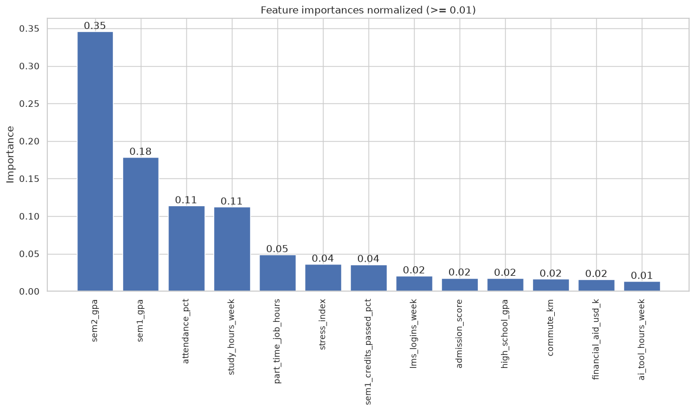

`sem2_gpa` (0.35) and `sem1_gpa` (0.18) dominate, followed by `attendance_pct` and `study_hours_week` (0.11 each). This metric is calculated on the training data and favours continuous variables, so we confirm it with the two methods below.

### Permutation importance (test, log-loss)

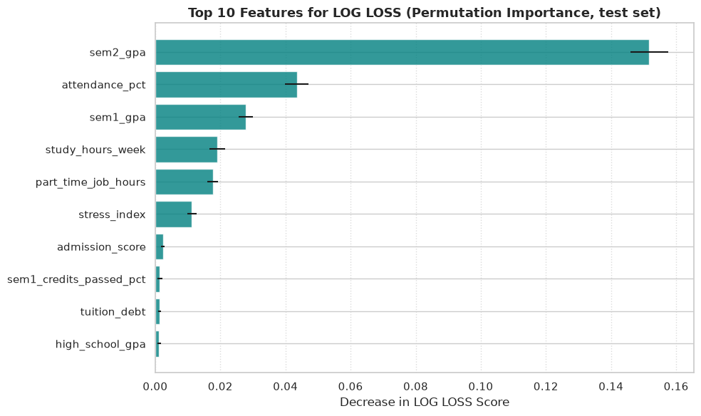

| Rank | Variable | Decrease in log-loss |
|---|---|---|
| 1 | `sem2_gpa` | ≈ 0.152 |
| 2 | `attendance_pct` | ≈ 0.043 |
| 3 | `sem1_gpa` | ≈ 0.028 |
| 4 | `study_hours_week` | ≈ 0.019 |
| 5 | `part_time_job_hours` | ≈ 0.018 |
| 6 | `stress_index` | ≈ 0.011 |

All other variables are close to zero. `sem1_gpa` ranks lower than in the impurity chart because it is strongly related to `sem2_gpa`: when one is shuffled, the model can partly rely on the other.

### SHAP (test)

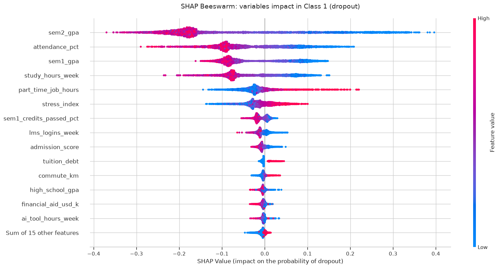

Direction of the effects (red = high value of the variable, blue = low; right = pushes towards dropout):

| Variable | Effect on dropout probability |
|---|---|
| `sem2_gpa`, `sem1_gpa` | Low GPA strongly **increases** risk (up to +0.4 for `sem2_gpa`); high GPA decreases it. |
| `attendance_pct` | Low attendance **increases** risk. |
| `study_hours_week` | Few study hours **increase** risk. |
| `part_time_job_hours` | Many working hours **increase** risk (up to +0.2). |
| `stress_index` | High stress **increases** risk. |
| `tuition_debt` | Having tuition debt slightly **increases** risk. |
| `sem1_credits_passed_pct`, `lms_logins_week`, `admission_score`, `high_school_gpa` | Small effects: higher values slightly reduce risk. |
| `gender_*`, `program_*` and the other variables | Negligible (grouped in "Sum of 15 other features"). |

#### Dependence plot: `study_hours_week`

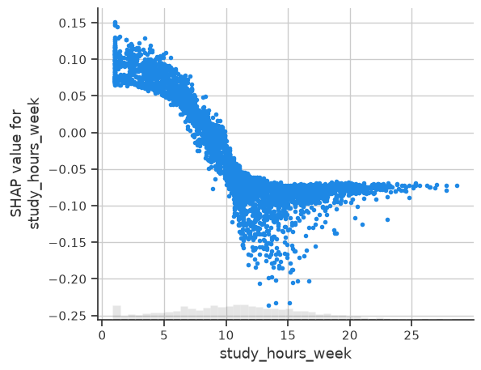

The effect is **non-linear**, with a clear threshold:
- below ~5 hours per week the dropout probability increases by about +0.07 to +0.15;
- between 5 and 11 hours the risk falls quickly;
- above ~11 hours the effect is flat (about −0.08): studying more than ~11 hours per week brings no additional reduction of risk.

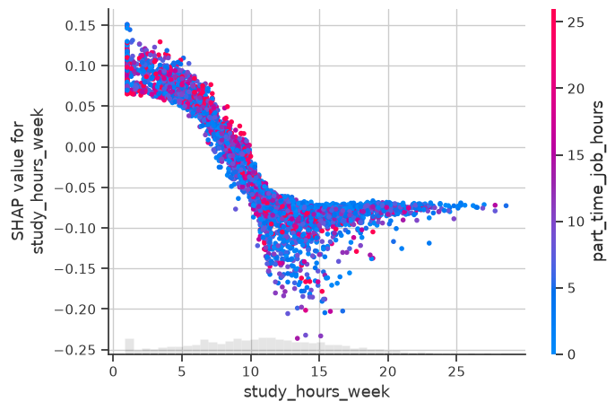

Colouring by `part_time_job_hours` shows no clear interaction: the colours are mixed along the curve. Study hours and working hours act mostly as separate risk factors.

Additional SHAP dependence plots: [automatic interaction](figures/09_shap_study_hours_interaction.png), [top 1](figures/11_shap_top_1.png), [top 2](figures/11_shap_top_2.png), [top 3](figures/11_shap_top_3.png).

**Findings**
- The three methods agree: **semester grades are the strongest early-warning signal**, followed by attendance and study habits.
- **Workload and wellbeing** (`part_time_job_hours`, `stress_index`) are the most important non-academic factors. These are areas where the university can act, for example through financial or psychological support.
- **Demographics and program do not predict dropout** in this data.

---

## 7. Choosing the cutoff with a cost matrix

Example assumptions (to be replaced with the university's real costs):

| Outcome | Value per student |
|---|---|
| True positive: student at risk detected and supported, tuition retained | +4,000 € |
| False positive: support given to a student who would not drop out | −500 € |
| False negative: student at risk not detected | −1,000 € |
| True negative | 0 € |

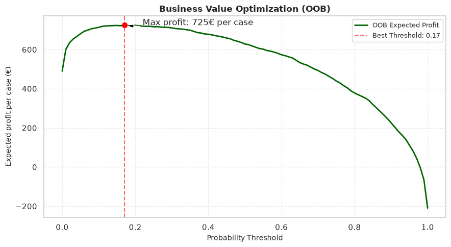

- With these costs, missing a dropout is much more expensive than an unnecessary intervention, so the **profit-optimal cutoff is low: 0.17** (OOB profit 725 € per student, against 629 € at 0.5).
- The cutoffs are not near 0.5 also because `class_weight='balanced_subsample'` shifts the predicted probabilities.

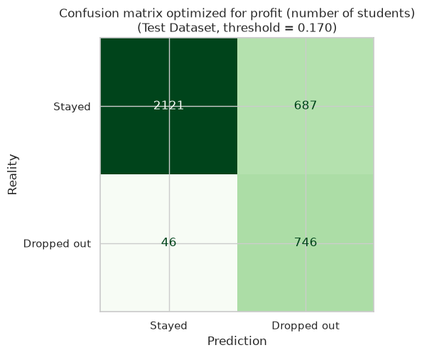

At cutoff 0.17 on the test set: 746 of 792 dropouts are detected (only 46 missed), at the cost of 687 false alarms.

### Comparison of cutoffs (test set)

All cutoffs were chosen with OOB predictions. The test set is only used to compare them.

| Cutoff type | Cutoff | Recall | Precision | F1 | Profit per student (€, test) |
|---|---|---|---|---|---|
| Default | 0.500 | 79.2% | 77.7% | 78.4% | 626 |
| F1-optimal (OOB) | 0.514 | 78.7% | 78.6% | 78.6% | 622 |
| Youden (OOB) | 0.347 | 88.0% | 66.9% | 76.0% | 700 |
| **Profit-optimal (OOB)** | **0.170** | **94.2%** | **52.1%** | **67.1%** | **721** |

**Findings**
- The profit-optimal cutoff chosen on OOB data also gives the highest profit on the test set (721 €), so the choice generalises.
- It trades precision for recall: about half of the flagged students would not have dropped out. This is acceptable only if interventions are cheap compared with the value of retaining a student.
- If support capacity is limited, the **Youden cutoff (0.35)** is a good compromise. It catches 88% of dropouts with fewer false alarms (precision 66.9%) and still gives 700 € per student.

---

## 8. Conclusions and limitations

**Conclusions**
1. A Random Forest predicts student dropout well (test AUC 0.95, F1 ≈ 78% at the default cutoff), and the result is consistent across CV, OOB and test.
2. Plain Bagging performs equally well. Decorrelating the trees (Random Forest) brings no measurable gain on this dataset.
3. Dropout risk is driven by grades, attendance, study time, working hours and stress, not by demographics.
4. The cutoff should be chosen according to the cost of interventions. With the example costs, a low cutoff (0.17) maximises value by catching 94% of students at risk.

**Limitations**
- **Timing of the predictors:** `sem2_gpa` is the most important variable, so the model is most useful **after the second semester**. To intervene earlier (e.g. after the first semester), the model should be retrained without `sem2_gpa`; its performance would probably be lower.
- **Cost matrix:** the monetary values are illustrative. The optimal cutoff depends directly on them and must be recalculated with real figures.
- **Probabilities are not calibrated** because of `class_weight='balanced_subsample'`. They should be used to rank students and apply a cutoff, not read as exact probabilities of dropout.
- **Correlated GPA variables:** importances are shared between `sem1_gpa` and `sem2_gpa`. Their individual importance should not be over-interpreted.
